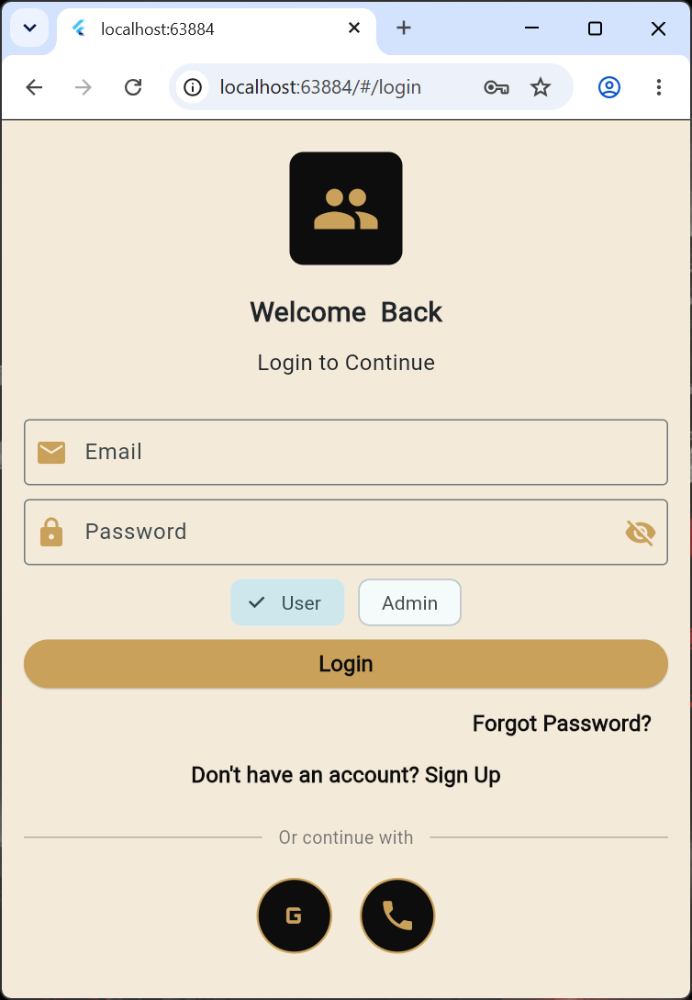
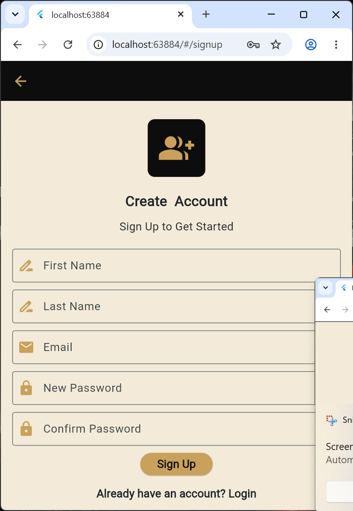
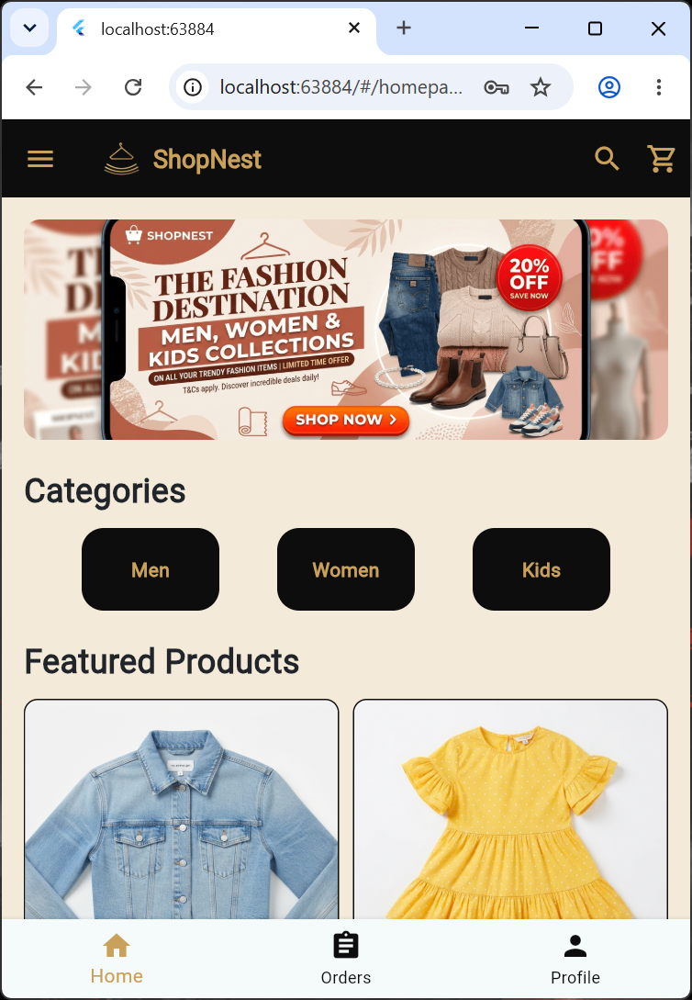
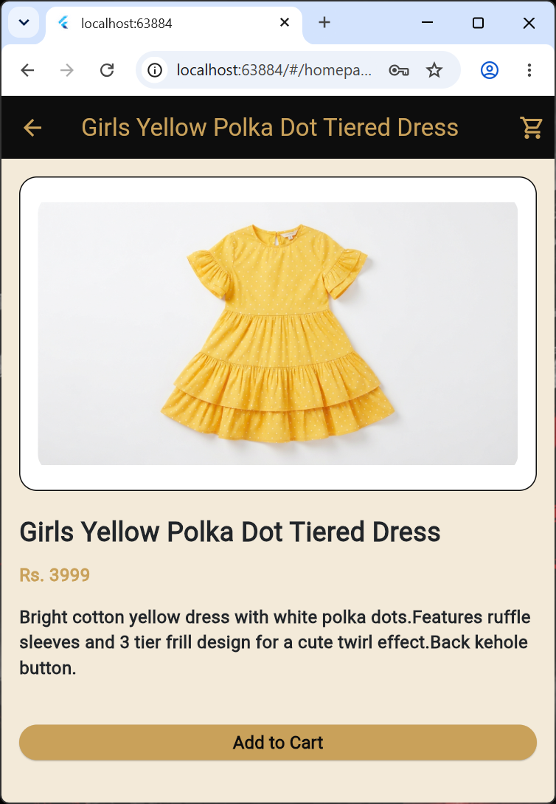
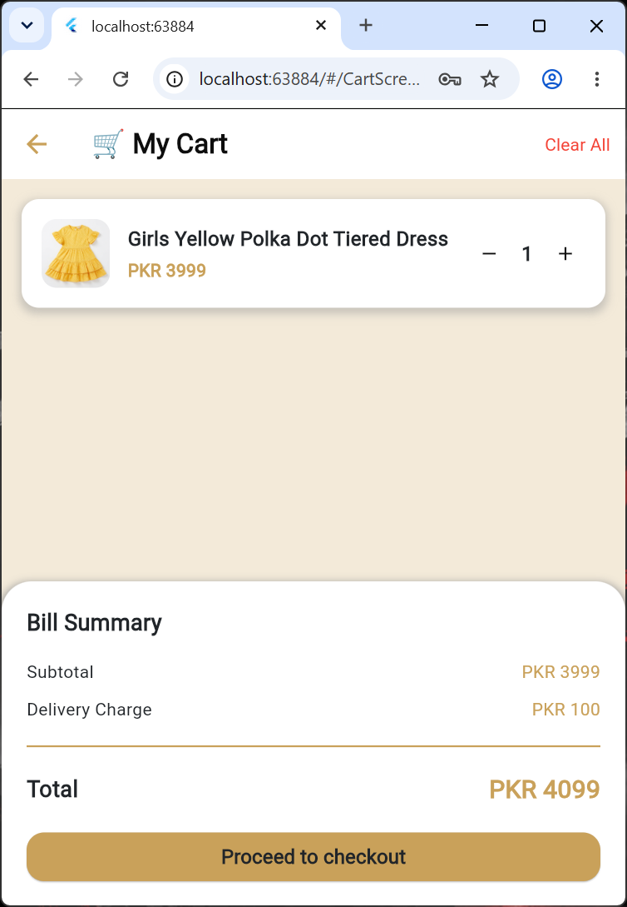
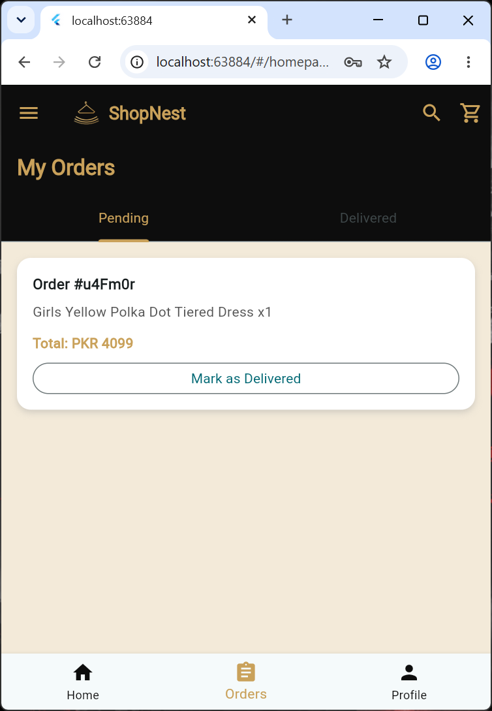
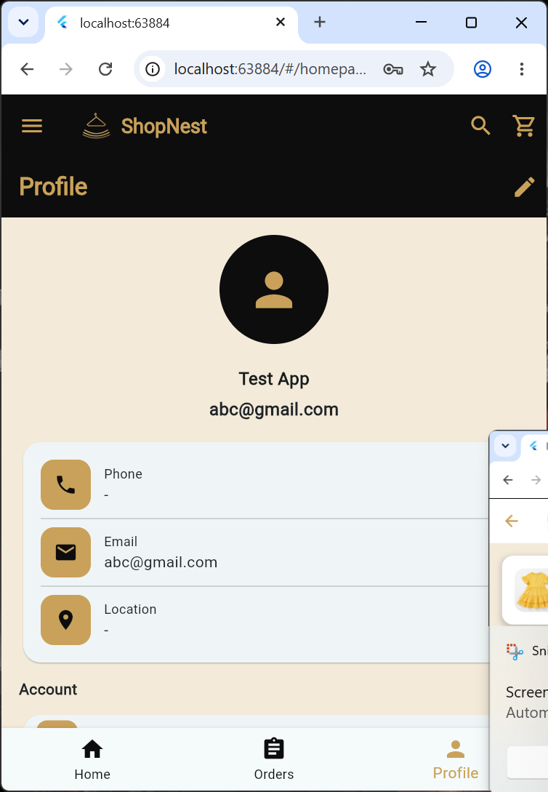
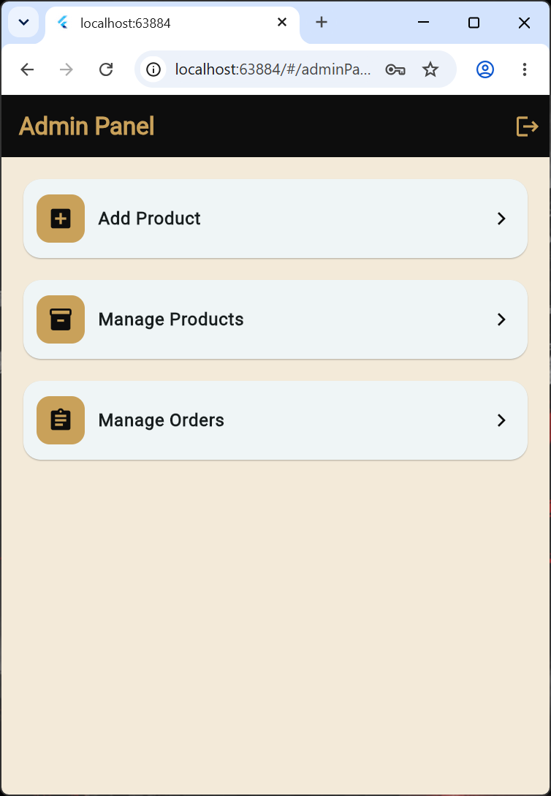

🛒 Flutter E-Commerce App

A feature-rich e-commerce mobile application built with **Flutter, Dart, and Firebase**. The application provides user authentication, product browsing, cart management, order placement, profile management, and an in-app admin panel for managing products and orders.

 ✨ Features

🔐 Authentication & User Management
- User registration and login with email and password.
- Google Sign-In integration.
- Phone authentication integration (availability may be limited by Firebase plan restrictions).
- User-specific data storage.
- Each user can access their own profile, cart, and order data.

🛍️ Shopping Experience
- Product listing and browsing.
- Organized product display.
- Product details.
- Add products to cart.
- Cart management.
- Order placement.
- Order history and order details.
- Cash on Delivery (COD) option.

🛠️ Admin Panel
- In-app admin panel.
- Add new products.
- Edit existing products.
- Manage product listings.
- View customer orders.
- Manage orders.

👤 Profile Management
- View user profile.
- Edit profile information.
- Profile photo support.
- Profile image storage using Firebase Storage.
- Navigation drawer displaying the user's profile photo and account information.

🔥 Firebase Integration
- Firebase Authentication for account management.
- Cloud Firestore for application data.
- Firebase Storage for profile photo storage.
- User-specific data organization.

🧰 Tech Stack

| Technology | Purpose |
|---|---|
| Flutter | Cross-platform mobile development |
| Dart | Application programming language |
| Firebase Authentication | User authentication |
| Cloud Firestore | Database and user-specific data |
| Firebase Storage | Profile photo storage |
| Google Sign-In | Google authentication |

📱 App Screenshots

| Screen | Screenshot |
|---|---|









🚀 Getting Started

Prerequisites
- Flutter SDK
- Dart SDK
- Android Studio or VS Code
- Firebase project
- Git

Installation

1. Clone the repository:

   ```bash
   git clone YOUR_GITHUB_REPOSITORY_URL
   ```

2. Navigate to the project directory:

   ```bash
   cd YOUR_PROJECT_FOLDER
   ```

3. Install dependencies:

   ```bash
   flutter pub get
   ```

4. Configure Firebase for your project:

   ```bash
   dart pub global activate flutterfire_cli
   flutterfire configure
   ```

5. Run the application:

   ```bash
   flutter run
   ```

🔒 Data Privacy & Authentication Notes

- User-specific data is organized so users can access their own account information, cart, and orders.
- Firebase Authentication is used for account management.
- Phone authentication availability may be limited by Firebase plan restrictions and configuration.
- Admin operations should be protected using backend-enforced authorization and appropriate Firebase Security Rules.

💳 Payment Method

Currently, the application supports **Cash on Delivery (COD)**.

Online payment gateway integration is not included.

🔮 Future Improvements

- Online payment gateway integration.
- Push notifications.
- Product ratings and reviews.
- Wishlist functionality.
- Advanced product search and filtering.
- Admin dashboard analytics.
- Improved state management.

👨‍💻 Developer

Developed as a Flutter e-commerce application project using Firebase services.

---

⭐ If you find this project useful, consider giving the repository a star!
